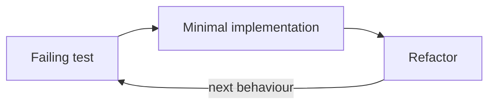

# Testing standards

Read this before you write or review tests.

Related: [typescript.md](typescript.md).

The goal is **confidence to change the system**, not maximum test volume or testing implementation details.

## Test behaviour, not implementation

Tests should prove observable behaviour through public APIs.

Use RED → GREEN → REFACTOR for new or changed behaviour.

Prefer:

```ts
test(
  "denies a refund when the user lost the finance permission after the order was placed",
);
```

Avoid:

```ts
test("calls checkPermission");
```

Tests should survive internal refactoring when the behaviour has not changed.

## Prefer test-first when useful

Writing the test before the implementation is encouraged, especially for:

- domain behaviour
- bug fixes
- edge cases
- state transitions
- regressions

A useful cycle is:



Do not treat TDD as ceremony. The important thing is that behaviour is clearly specified and protected by tests.

The acceptance criteria in the issue or specification for a change are the primary testing boundary. Each one is a candidate test.

## Test through public APIs

Exercise modules through the interfaces used by their consumers. For a package, that is what its `exports` field exposes.

Do not test private helpers directly unless they represent a real standalone contract.

If changing an internal implementation breaks many tests without changing behaviour, the tests are probably coupled too closely to the implementation.

## Fake at boundaries

Use real application code wherever practical: the real HTTP handlers, the real database, and the real queues and workers, run locally. Database code is tested against a real database.

Fake the systems that are external, expensive, slow or outside our control:

| Boundary                                 | Fake                                                                                              |
| ---------------------------------------- | ------------------------------------------------------------------------------------------------- |
| AI model APIs                            | a scripted fake model server that speaks the model API                                            |
| Outbound email                           | a fake behind the email port that records sent messages and returns delivery events               |
| Telemetry and tracing                    | a fake OTLP endpoint that records traces, so tests can check that sensitive payloads are withheld |
| Inbound email                            | raw MIME fixtures sent to the real handler                                                        |
| Integrations, such as a payment provider | a fake server with real behaviour for the scenario                                                |
| Identity provider (SSO, OIDC)            | a fake issuer that signs test tokens                                                              |
| Search                                   | a fake retrieval server, or a real local index where the harness supports it                      |

When more than one package needs a fake or a factory, put it in a test-support package under `packages/`.

A fake is a small server or object with real behaviour for the scenario, not a list of expected calls.

Do not mock our own domain logic or orchestration to make a test easier to write. Do not use module mocking: `mock.module()` from `bun:test`, `vi.mock` or `jest.mock`. The anti-slop lint rule `no-module-mocking` refuses it. Pass the dependency in instead.

Prefer testing:

```text
real application behaviour + controlled external boundary
```

## Prefer scenarios over mock choreography

Describe the situation being tested rather than scripting internal calls.

Prefer scenarios such as:

```text
The integration is unavailable
The record changed since it was read
The policy requires approval
The agent requires human judgement
The input is invalid against its schema
Two users edit the same record
```

Avoid tests built around long sequences of `mockReturnValue`, spies and call-count assertions.

## Independent tests

Tests must not depend on execution order or shared mutable state.

Prefer factory functions over `beforeEach` and mutable variables:

```ts
const createTestSetup = () => ({
  account: createAccount(),
  order: createOrder(),
});
```

Each test should make its important setup visible.

In a multi-tenant system, each test creates its own tenant. Tenant isolation is part of every test, not a special case.

## Test data factories

Use factories for domain objects with sensible valid defaults.

Factories may accept explicit overrides:

```ts
const order = await createOrder({
  note: "Refund for a duplicate charge",
});
```

Do not duplicate large object literals across tests.

Factories are test helpers, not alternative domain models. They build values through production contracts and schemas. Use placeholder personal data only. Do not copy real customer data into fixtures.

## Test names describe behaviour

A test name should explain what the system guarantees.

Prefer:

```ts
test("requires human approval when a refund exceeds the account limit");
```

Avoid:

```ts
test("returns false");
test("works correctly");
test("calls requestApproval");
```

## Test at the appropriate level

Use the smallest test that gives useful confidence.

| Level             | Covers                                                       | Where                                                                |
| ----------------- | ------------------------------------------------------------ | -------------------------------------------------------------------- |
| Domain tests      | business rules, state transitions, failures and edge cases   | pure functions in `packages/*`                                       |
| Adapter tests     | translation at system boundaries                             | parsers, API clients and integration adapters, against their fakes   |
| Integration tests | important components working together                        | each app over its real interface, such as HTTP, with a real database |
| Browser tests     | a small number of critical user journeys                     | Playwright, when the project has a web UI                            |
| Replay tests      | what an agent does next, from a fixed run log, with no model | when the project has AI agents                                       |
| Evals             | whether an agent reaches a good outcome with the real models | when the project has AI agents                                       |

Do not repeat the same behavioural assertion at every layer.

## Agent behaviour

When the project has AI agents, test them through observable state transitions and outcomes.

Prefer:

```text
Given an order with a duplicate charge
When the support agent proposes a refund above the policy limit
Then the agent run is awaiting approval
And an ApprovalRequested event is recorded
```

Avoid relying on:

- exact prompt text
- model call counts
- internal orchestration order
- private implementation details

Only assert these when they are themselves part of the contract.

Tests cannot prove that an agent behaves well with a real model. Evals do. A change to agent behaviour needs both: tests and replay tests for the code, and evals for the behaviour.

## Failures and edge cases

Important behaviour includes more than the happy path.

Test where relevant:

- expected domain failures
- boundaries
- empty values
- stale state
- retries
- invalid external data
- partial failure
- concurrency-sensitive behaviour
- recovery after a restart
- cross-tenant access attempts

Do not add edge-case tests mechanically where no meaningful behaviour exists.

## Types apply to tests too

Test code follows the same [TypeScript standards](typescript.md) and the same lint rules as production code.

Do not use `any`, unjustified assertions or weaker types just because the code is in a test.

Reuse production contracts where those contracts are part of what the test is proving.

## Coverage

Coverage is a backstop, not the goal.

High coverage is valuable for core domain behaviour, but do not write tests purely to satisfy a percentage.

A well-tested module should give us confidence that meaningful behaviour, failure modes and important branches are protected.

## Running tests

Tests use `bun:test`. Turborepo runs each task in every package that defines it, and caches the result.

| Command                                      | Runs                                                 |
| -------------------------------------------- | ---------------------------------------------------- |
| `bun run test`                               | the test suites in every package (`turbo run test`)  |
| `bunx turbo run test --filter=<package>`     | the test suite for one package, such as `@repo/core` |
| `bun test <file>`, in the package folder     | one test file                                        |
| `bun test --coverage`, in the package folder | the package's tests, with a coverage report          |

Tests that cost money or reach real providers, such as live checks and evals, stay out of `test`. Give each one its own script, so that CI and agents do not run them by accident.

- Run the tests for the code you changed while you work. Run the whole suites before you call a goal done.
- When several agents share one checkout, run browser tests with one worker and your own port, and run the whole suites once, in a clean worktree.
- A test that times out under load is not proof of a bug. Run the file again on its own before you call it a failure. A test that fails on its own is a real failure.
- A test that fails sometimes is a bug in the test or the code. Fix it, or record it with its owner. Do not retry it until it passes and move on.
