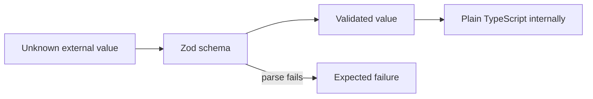

# TypeScript standards

Read this before you write or review TypeScript.

The goal is **strong types and simple code**, not clever TypeScript.

## Compiler

`packages/typescript-config/base.json` sets these flags. Every package extends it. Do not turn one off to make code compile. Fix the code.

```text
strict
exactOptionalPropertyTypes
noUncheckedIndexedAccess
noPropertyAccessFromIndexSignature
noImplicitOverride
noImplicitReturns
noFallthroughCasesInSwitch
noUnusedLocals
noUnusedParameters
allowUnreachableCode: false
allowUnusedLabels: false
noUncheckedSideEffectImports
forceConsistentCasingInFileNames
erasableSyntaxOnly
isolatedModules
verbatimModuleSyntax
```

- `strict` turns on `noImplicitAny`, `strictNullChecks` and `useUnknownInCatchVariables`. A caught error is `unknown`. Narrow it before you use it.
- `verbatimModuleSyntax` and `isolatedModules`: import a type with `import type`, so each file compiles on its own.
- `noUncheckedSideEffectImports`: an import with no bindings, such as a stylesheet, must resolve.
- `erasableSyntaxOnly`: the compiler refuses syntax that emits code, such as `enum`, `namespace` and constructor parameter properties.

The base config also loads `@total-typescript/ts-reset`. For example, `JSON.parse` returns `unknown`.

ESLint enforces many rules in this file. `eslint.config.js` turns on the typescript-eslint `strictTypeChecked` and `stylisticTypeChecked` presets, extra rules, and the anti-slop rules in `tools/eslint/anti-slop/`. Do not turn off a rule to make code pass. Fix the code.

## No `any`

- Do not use `any`. ESLint refuses it.
- If a third-party library forces `any`, contain it at the smallest boundary. Do not let it leak.

## Avoid type assertions

Do not use `as SomeType` in place of modelling or validation.

Assertions must be rare, local and justified. Acceptable cases: tightly contained interop, or branded-value construction after the invariant is set up. Put a `// SAFETY:` comment immediately before the assertion, or before the statement that contains it, and say why it is true. ESLint refuses an assertion without one.

Use `satisfies` when you want to check a value against a type and keep its own, narrower type. ESLint refuses `as` on an object literal.

```ts
const retryLimits = {
  email: 3,
  sms: 5,
} satisfies Record<Channel, number>;
```

Do not use non-null assertions (`value!`). Handle the missing case, or change the type so the value cannot be missing. ESLint refuses `!`.

## `undefined` and `null`

- `undefined` means "not given": an optional parameter, an optional property or a missing key. With `exactOptionalPropertyTypes`, leave the key out. Do not set it to `undefined` unless the type says `| undefined`.
- `null` means "known to have no value" in data that is stored or sent: `shippedAt: null` before an order ships. JSON has no `undefined`, so wire and storage shapes use `null`.
- Do not allow both for one field. Pick the one that matches its meaning. ESLint refuses a type that allows both.

## Literal unions, not `enum`

Use a union of string literals, with a `const` array when code must list the values:

```ts
export const orderStatuses = [
  "pending",
  "paid",
  "shipped",
  "delivered",
  "cancelled",
] as const;

export type OrderStatus = (typeof orderStatuses)[number];
```

Do not use TypeScript `enum` or `const enum`. They emit code, and they do not match the strings on the wire. `erasableSyntaxOnly` refuses them.

## Make illegal states unrepresentable

Model state so that a wrong combination cannot be written.

Prefer:

```ts
type Payment =
  | { readonly kind: "pending" }
  | { readonly kind: "authorised"; readonly authorisationId: AuthorisationId }
  | { readonly kind: "failed"; readonly reason: DeclineReason }
  | { readonly kind: "captured"; readonly capturedAt: Date };
```

Avoid:

```ts
type Payment = {
  status: string;
  authorisationId?: AuthorisationId;
  reason?: string;
  capturedAt?: Date;
};
```

Booleans and optional fields that only make sense together are a sign that a discriminated union is missing.

## Schema-first at trust boundaries

Use **Zod** where data crosses an untrusted boundary:

- HTTP input
- WebSocket and queue messages
- environment and configuration
- third-party API responses
- webhook payloads
- AI structured output
- stored data that crosses a version boundary



Do not create Zod schemas for internal objects. After the trust boundary, plain TypeScript types are enough.

**Parse, don't validate.** Parse the value once, at the boundary, and pass on the parsed value with its type. Do not check a value and then keep using the unchecked one. Derive the TypeScript type from the schema with `z.infer`, so the two cannot drift.

ESLint enforces this in two ways:

- A function does not take an `unknown` parameter. Parse the value first, then pass the parsed type.
- Code does not narrow outside data by hand with `typeof`. Use a schema.

`JSON.parse` returns `unknown`, so pass its result straight to a schema.

## One owner per contract

Each meaningful contract has one canonical definition. Do not redefine an equivalent schema, message shape or state type in another package or in a test.

A contract that more than one package uses lives in one package under `packages/`. Other packages import it through that package's `exports`.

Tests reuse production contracts where the contract is part of what they test.

## Branded identifiers

Brand an identifier where confusing two primitives would cause a real bug, such as passing an `OrderId` where a `CustomerId` is expected. In a multi-tenant system, brand the tenant identifier first. Confusing it causes a cross-tenant data leak.

Brand the identifier in its schema, so that parsing creates the brand:

```ts
export const OrderId = z.uuid().brand<"OrderId">();

export type OrderId = z.infer<typeof OrderId>;
```

## Discriminated unions

Model lifecycle and protocol state as explicit variants, such as `Payment` above.

Make every switch over these variants exhaustive. A new variant must break the build until every relevant switch handles it.

Write one `case` for each variant. Do not add a `default` clause to a switch over a union. ESLint (`switch-exhaustiveness-check`) reports a switch that misses a variant, and a `default` clause does not count as handling one.

A switch over an open value, such as an HTTP method or a string from outside the application, must have a `default` clause. ESLint refuses one without it.

## Function parameters

- A function with two or more parameters takes one options object. Names at the call site say what each value is. ESLint refuses two or more positional parameters. Inline callbacks, such as `reduce((total, item) => ...)`, are exempt.
- Do not pass a positional boolean. `render(order, true)` says nothing. Use a named option or a literal union: `render({ order, mode: "readonly" })`.

## Simple generics

Use a generic when a function really works for many types and the caller needs the type back, such as a result or a collection helper.

Do not write clever type-level code: deep conditional types, recursive mapped types or type-level parsing. If a type needs a comment to explain how it works, use a simpler type, even if it is a little less precise. ESLint refuses a conditional type inside another.

## Immutable data

Application data is immutable by default.

- Use `readonly` and `ReadonlyArray<T>`. ESLint refuses `readonly T[]`.
- Return updated values. Do not mutate inputs. ESLint refuses assignment to a parameter or to its properties.

## Functional light

Use practical functional patterns without a framework.

Prefer:

- small pure functions
- composition
- immutable data
- early returns
- array transformations
- options objects

Avoid:

- deep nested conditionals (ESLint refuses blocks nested more than 3 deep)
- inheritance-heavy designs
- mutation-heavy services
- complicated FP abstractions
- monadic frameworks
- abstraction for its own sake

The test: **does this make the behaviour easier for a human or coding agent to understand?**

## Expected failures as values

When failure is expected domain behaviour, return an explicit result type (`Success | Failure`). Do not rely only on exceptions.

Examples:

- permission denied
- payment declined
- record changed since it was read
- third-party service unavailable
- input invalid against its schema
- order already cancelled

Unexpected infrastructure or programming failures may throw. Handle them at system boundaries.

## Small public module surfaces

A module may hold many internal helpers. It exposes only the small set of operations the rest of the application needs.

Small functions do not mean hundreds of public modules. Keep the public architecture easy to understand.

In the monorepo, each package exposes its public surface through the `exports` field in its `package.json`. Do not import from another package's internal paths.
