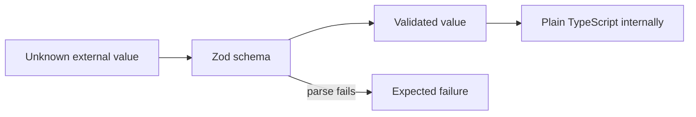

# TypeScript standards

Read this before you write or review TypeScript.

The goal is **strong types and simple code**, not clever TypeScript.

Paths marked _(planned)_ do not exist yet.

## Compiler

`packages/typescript-config/base.json` sets these flags. Every package extends it. Do not turn one off to make code compile. Fix the code.

```text
strict
exactOptionalPropertyTypes
noUncheckedIndexedAccess
noPropertyAccessFromIndexSignature
noImplicitOverride
noImplicitReturns
noFallthroughCasesInSwitch
noUnusedLocals
noUnusedParameters
allowUnreachableCode: false
allowUnusedLabels: false
noUncheckedSideEffectImports
forceConsistentCasingInFileNames
erasableSyntaxOnly
isolatedModules
verbatimModuleSyntax
```

- `strict` turns on `noImplicitAny`, `strictNullChecks` and `useUnknownInCatchVariables`. A caught error is `unknown`. Narrow it before you use it.
- `verbatimModuleSyntax` and `isolatedModules`: import a type with `import type`, so each file compiles on its own.
- `noUncheckedSideEffectImports`: an import with no bindings, such as a stylesheet, must resolve.
- `erasableSyntaxOnly`: the compiler refuses syntax that emits code, such as `enum`, `namespace` and constructor parameter properties.

The base config also loads `@total-typescript/ts-reset`. For example, `JSON.parse` returns `unknown`.

ESLint enforces many rules in this file. `eslint.config.js` turns on the typescript-eslint `strictTypeChecked` and `stylisticTypeChecked` presets, extra rules, and the anti-slop rules in `tools/eslint/anti-slop/`.

## No `any`

- Do not use `any` in application code.
- At untrusted boundaries use `unknown` and narrow it through validation.
- If a third-party library forces `any`, contain it at the smallest boundary. Do not let it leak.

## Avoid type assertions

Do not use `as SomeType` in place of modelling or validation.

Assertions must be rare, local and justified. Acceptable cases: tightly contained interop, or branded-value construction after the invariant is set up. Put a `// SAFETY:` comment above each one that says why it is true.

Use `satisfies` when you want to check a value against a type and keep its own, narrower type:

```ts
const toolLimits = {
  "conversation.reply": 20,
  "conversation.addNote": 10,
} satisfies Record<CapabilityId, number>;
```

Do not use non-null assertions (`value!`). Handle the missing case, or change the type so the value cannot be missing. ESLint refuses `!`.

## `undefined` and `null`

- `undefined` means "not given": an optional parameter, an optional property or a missing key. With `exactOptionalPropertyTypes`, leave the key out. Do not set it to `undefined` unless the type says `| undefined`.
- `null` means "known to have no value" in data that is stored or sent: `assignee: null` before a conversation is assigned. JSON has no `undefined`, so wire and storage shapes use `null`.
- Do not allow both for one field. Pick the one that matches its meaning.

## Literal unions, not `enum`

Use a union of string literals, with a `const` array when code must list the values:

```ts
export const conversationStatuses = [
  "open",
  "pending",
  "snoozed",
  "resolved",
  "closed",
] as const;
export type ConversationStatus = (typeof conversationStatuses)[number];
```

Do not use TypeScript `enum` or `const enum`. They emit code, and they do not match the strings on the wire. `erasableSyntaxOnly` refuses them.

## Make illegal states unrepresentable

Model state so that a wrong combination cannot be written.

Prefer:

```ts
type AgentRun =
  | { readonly kind: "working"; readonly step: number }
  | { readonly kind: "failed"; readonly reason: FailureReason }
  | { readonly kind: "escalated"; readonly approvalId: ApprovalId }
  | { readonly kind: "completed"; readonly outcome: RunOutcome };
```

Avoid:

```ts
type AgentRun = {
  status: string;
  step?: number;
  reason?: string;
  approvalId?: ApprovalId;
};
```

Booleans and optional fields that only make sense together are a sign that a discriminated union is missing.

## Schema-first at trust boundaries

Use **Zod** where data crosses an untrusted boundary:

- HTTP input
- WebSocket messages
- environment and configuration
- inbound email and chat payloads
- integration API responses, such as Stripe, where required
- AI structured output, including generated `SurfaceDefinition` values
- persisted data that crosses versioned boundaries, such as stored surfaces
- external event and webhook payloads



Do not create Zod schemas for internal objects. After the trust boundary, plain TypeScript types are enough.

**Parse, don't validate.** Parse the value once, at the boundary, and pass on the parsed value with its type. Do not check a value and then keep using the unchecked one. Do not narrow outside data by hand with `typeof` checks. Derive the TypeScript type from the schema with `z.infer`, so the two cannot drift. Text that may be JSON goes through `parseUntrustedJson` in `packages/contracts/src/json.ts` _(planned)_, which returns a `JsonValue`, then through a schema.

## One owner per contract

Each meaningful contract has one canonical definition. Do not redefine equivalent Conversation schemas, capability definitions, `SurfaceDefinition` shapes, AgentRun states, WebSocket messages or test fixture schemas across packages or tests.

In this monorepo the owner of a shared contract is `packages/contracts` _(planned)_. Apps and other packages import from it.

Tests reuse production contracts where the contract is part of what they test.

## Branded identifiers

Brand identifiers where confusing two primitives would cause a real bug:

```text
WorkspaceId
UserId
TeamId
CustomerId
AccountId
ConversationId
MessageId
CapabilityId
SurfaceId
AgentRunId
ApprovalId
```

`WorkspaceId` matters most. Confusing it causes a cross-tenant data leak.

## Discriminated unions

Model lifecycle and protocol state as explicit variants.

```text
AgentRunState: queued | compiling_context | working | awaiting_approval | escalated | completed | failed

DomainEvent: ConversationCreated | MessageReceived | MessageSent | ConversationAssigned
           | ConversationStatusChanged | ApprovalRequested | ApprovalDecided | AgentRunCompleted

PolicyDecision: allow | deny | require_approval
```

Make every switch over these variants exhaustive. A new variant must break compilation until every relevant switch handles it.

Write one `case` for each variant. Do not add a `default` clause to a switch over a union. A `default` catches a new variant silently, so the compiler cannot tell you about it.

A switch that returns a value is exhaustive through its return type and `noImplicitReturns`. Do not add a check to it.

A switch that returns no value needs an explicit check. Call `assertNever` from `packages/contracts/src/assert-never.ts` _(planned)_ in the `default` clause:

```ts
switch (message.type) {
  case "presence.join":
    joinPresence(message);
    break;
  case "draft.update":
    updateDraft(message);
    break;
  default:
    assertNever({ value: message, name: "inbox socket message" });
}
```

Use a `default` clause without this check only for an open value, such as an HTTP method or a string from outside the application.

## Function parameters

- A function with two or more parameters takes one options object. Names at the call site say what each value is.
- Do not pass a positional boolean. `render(surface, true)` says nothing. Use a named option or a literal union: `render({ surface, mode: "readonly" })`.

## Simple generics

Use a generic when a function really works for many types and the caller needs the type back, such as a result or a collection helper.

Do not write clever type-level code: deep conditional types, recursive mapped types or type-level parsing. If a type needs a comment to explain how it works, use a simpler type, even if it is a little less precise.

## Immutable data

Application data is immutable by default.

- Use `readonly` and `ReadonlyArray<T>`.
- Return updated values. Do not mutate inputs.

This matters most for surface definitions, compiled context, agent state, AgentRun state, events, approvals and policy decisions.

## Functional light

Use practical functional patterns without a framework.

Prefer:

- small pure functions
- composition
- immutable data
- early returns
- array transformations
- options objects

Avoid:

- deep nested conditionals
- inheritance-heavy designs
- mutation-heavy services
- complicated FP abstractions
- monadic frameworks
- abstraction for its own sake

The test: **does this make the behaviour easier for a human or coding agent to understand?**

## Expected failures as values

When failure is expected domain behaviour, return an explicit result type (`Success | Failure`). Do not rely only on exceptions.

Examples:

- capability denied by permission or policy
- approval required
- surface version stale
- integration unavailable
- model output invalid against the surface catalogue
- conversation already resolved

Unexpected infrastructure or programming failures may throw. Handle them at system boundaries.

## Small public module surfaces

A module may hold many internal helpers. It exposes only the small set of operations the rest of the application needs.

Small functions do not mean hundreds of public modules. Keep the public architecture easy to understand.

In the monorepo, each package exposes its public surface through the `exports` field in its `package.json`. Do not import from another package's internal paths.
